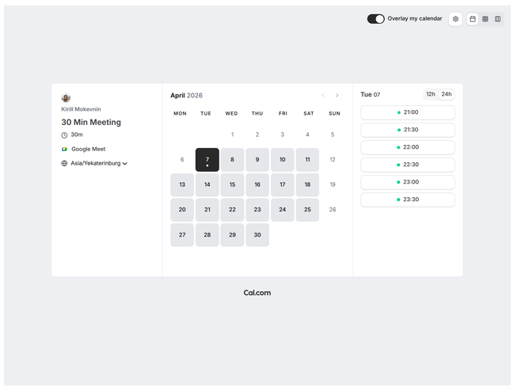
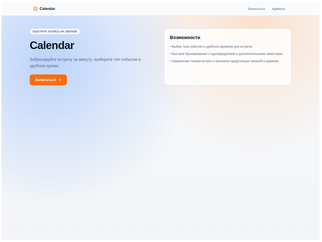
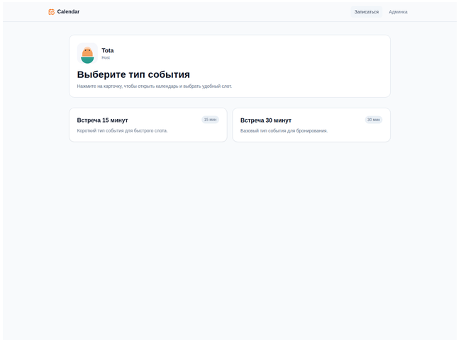
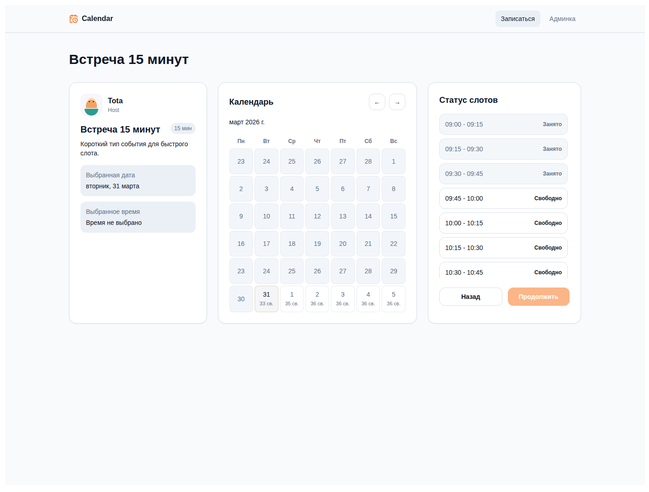

Чему учимся

В этом проекте мы проходим полный цикл разработки небольшого веб-приложения, где основным исполнителем выступает ИИ-агент. Сначала собираем каркас приложения и настраиваем агентную среду, затем проектируем функциональность через спецификацию, реализуем её по тикетам и публикуем сервис.

Работа идёт одним циклом: обсудили задачу, зафиксировали спецификацию, разложили её на тикеты, реализовали. Каждый шаг проекта называет, какой скилл вызвать и что должно остаться в репозитории после него.

Ключевой формат работы в этом проекте: всю разработку ведём с помощью ИИ-агентов. В идеале вы не пишете вручную ни одной строки кода: формулируете задачу агенту, проверяете результат и итеративно улучшаете решение.

Проект можно выполнить на любом стеке технологий. Ограничение задаёт итоговый результат: приложение должно собираться в Docker-образ и запускаться в контейнере. Такой формат позволяет сосредоточиться на процессе разработки и на устройстве приложения.
Описание проекта

«Запись на звонок» это упрощённый сервис бронирования времени по мотивам Cal.com.

Cal.com это сервис, где пользователь публикует доступные интервалы, а другой человек выбирает свободное время и бронирует встречу. У нашего приложения тот же базовый сценарий: владелец публикует доступное время для встреч, а другой пользователь выбирает свободный слот и записывается на звонок.

В проекте нет авторизации, личных кабинетов и интеграций с внешними календарями. Функциональность намеренно ограничена, чтобы сосредоточиться на главном.

В результате должно получиться небольшое, но законченное приложение.

Владелец календаря в приложении один и задан заранее. Он заводит типы встреч, у каждого есть название, описание и длительность, и смотрит список предстоящих встреч всех типов. Гость заходит без регистрации, выбирает тип встречи, открывает календарь на ближайшие 14 дней и записывается на свободный слот. Слот длится столько, сколько выбранный тип встречи. Одно и то же время нельзя занять дважды, даже разными типами встреч.

Этого достаточно, чтобы пройти весь путь от проектирования до запуска сервиса в облаке.

Стек вы выбираете сами. Обязательная часть работы с API состоит из TypeSpec-контракта, сгенерированной OpenAPI-спецификации и клиентского SDK для фронтенда. До выбора инструментов проверьте, что для языка фронтенда есть генератор клиента из OpenAPI. Серверные типы и маршруты генерируются, если выбранный фреймворк это поддерживает. При отсутствии серверного генератора бекенд реализуется по контракту и проверяется тестами.

Окно записи занимает 14 календарных дней и сдвигается с течением времени. Начало с сегодняшнего или завтрашнего дня, часы работы владельца и часовой пояс вы выбираете и записываете в спецификации. Длительность слота совпадает с длительностью типа встречи, шаг доступных стартов тоже фиксируется в спецификации. Пересечение интервалов запрещено, включая частичное наложение разных типов. Следующая встреча может начинаться в момент окончания предыдущей. Правила действуют и для двух запросов, пришедших одновременно.

Данные можно хранить в памяти процесса. В этом случае перезапуск сбрасывает записи, и это ограничение нужно назвать в README.md. База с сохранением данных тоже допустима. Хранение после перезапуска отдельным условием приёмки не является.

Пример того, что может получиться:

Ссылки

    Cal.com: референсный сервис, на который можно опираться при проектировании пользовательского сценария.

Задачи

    Откройте Cal.com и изучите референс. Для просмотра пользовательского пути можно зарегистрироваться.
    Пройдите путь создания типа встречи и записи на свободное время. Регистрация, внешние календари и уведомления Cal.com в задание не входят.
    Запишите в README.md репозитория проекта короткий сценарий от создания типа встречи до появления записи в списке владельца. До подготовки репозитория можно сохранить черновик локально. Используйте описание и экраны выше, если референсный сервис недоступен.

Результат шага

Сохранён сценарий гостя и владельца. Известны обязательные функции, ограничения приложения и требования к генерации клиента.